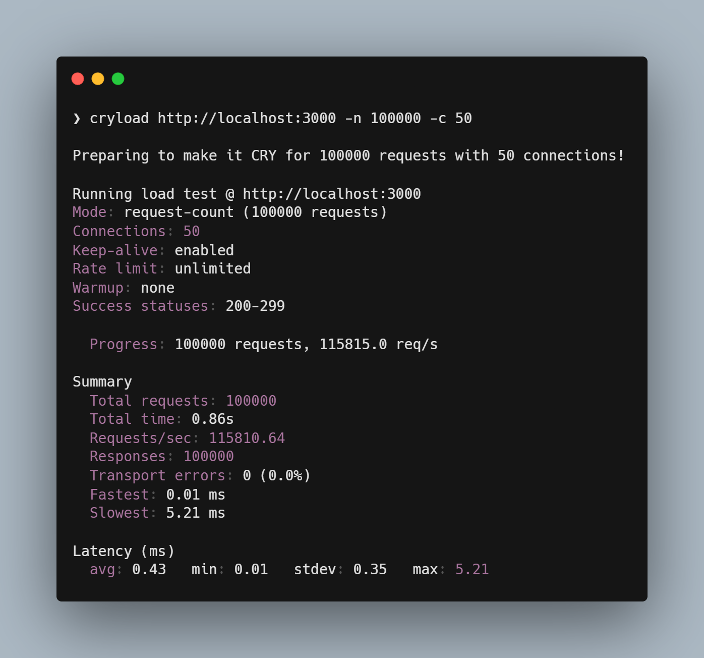

<p align="left">
  
</p>

# cryload - HTTP load testing for CI/CD

Cross-platform, single-binary HTTP load testing CLI. Honest latency, CI thresholds, JSON/CSV output. A modern alternative to `ab` / `wrk` / `hey`, written in Crystal.

[](https://github.com/sdogruyol/cryload)
[](https://github.com/sdogruyol/cryload/actions/workflows/ci.yml)
[](https://github.com/sdogruyol/cryload/releases)
[](https://github.com/sdogruyol/cryload/releases)

[](LICENSE)

---

## Quick start

```bash
curl -sSfL https://raw.githubusercontent.com/sdogruyol/cryload/master/scripts/install.sh | sh
cryload https://example.com -n 1000 -c 50
```

1000 requests, 50 concurrent connections, JSON/CSV/plain output. That's it.

<p align="center">
  
</p>

---

## Why cryload?

Existing tools work fine on your laptop. cryload is built for the one place that matters most: **CI/CD pipelines**.

| Problem | Solution |
|---------|----------|
| "Did my deploy break performance?" | Set latency thresholds that fail your build |
| "Where do I put the results?" | JSON and CSV output, ready to parse |
| "Different OS in CI vs local?" | Single binary for Linux, macOS, Windows |
| "Which tool works in all three?" | cryload does |

If you need a graph on your laptop, use wrk. If you need to **fail a pipeline when p99 goes over 200ms**, use cryload.

---

## Features

- ⚡ **Multi-core** load generation (`--workers`), concurrent connections (`-c`)
- ⏱️ **Duration** or **request count** mode
- 📊 **Latency percentiles**: p50, p75, p90, p95, p99, p999 + histogram
- 🎯 **Honest latency**: coordinated-omission-corrected percentiles and rate attainment
- 🔍 **Phase breakdown**: DNS, connect, TLS, TTFB — see where the time actually went
- 🗂️ **Per-URL** and **per-status** breakdowns, not just one global number
- 🎯 **CI threshold matrix**: `--max-p50` … `--max-p999`, `--max-avg`, `--max-latency`, `--min-rps`, `--max-fail-rate`, per-endpoint `--url-threshold`
- 🚦 **Exit code taxonomy**: slow service, unreachable target and bad config are different codes
- 📦 **JSON / CSV / quiet** output for pipelines, with a versioned schema
- 🔒 **Rate limiting**, warmup, keep-alive control, request deadlines, TLS skip
- 🌐 **Multi-URL**, redirects, proxy, cookies, custom success codes
- 🖥️ **Cross-platform**: Linux, macOS, Windows - single binary

---

## Performance

cryload is fast. Written in Crystal, compiled to native code, and multi-core by default since 6.0.0.

All figures below are the **median of 5 runs**, with the observed spread, because
a single run of a load generator on a shared machine is noise, not a number.

| Test | Throughput (median of 5) | Spread | p99 |
|------|--------------------------|--------|-----|
| `--workers 8 -c 128 -d 3` | **329,440 req/sec** | 296k – 342k | 1.95 ms |
| `--workers 16 -c 128 -d 3` | 280,079 req/sec | 278k – 301k | 2.34 ms |
| `--workers 4 -c 128 -d 3` | 210,668 req/sec | 190k – 240k | 2.38 ms |
| `--workers 1 -c 128 -d 3` (v5-equivalent single-thread path) | **109,161 req/sec** | 108k – 114k | 2.94 ms |
| `--workers 1 -c 64 -d 3` | 138,106 req/sec | 110k – 143k | 1.32 ms |

| | |
|---|---|
| Peak RSS (`--workers 8 -c 128`, 2-byte bodies) | 22.9 MB |
| Peak RSS (`--workers 1 -c 64`, 2-byte bodies) | 15.7 MB |
| Peak RSS (`--workers 8 -c 32`, 100 KB bodies) | 12.9 MB |
| Binary size | ~1.4 MB stripped, single file, no runtime dependencies |

Large responses cost *less* memory than many small ones, because bodies are
streamed through one fixed buffer per worker rather than materialised as a
String.

Multi-core buys **3.0x** on this hardware. Note that `--workers 16` measures
*slower* than `--workers 8`: once the schedulers outnumber the useful work they
fight each other and the target for cores. That is why the default is
`min(cpu cores, connections)` rather than "all of them", and why `--workers` is a
dial worth turning rather than a number to max out.

**Methodology.** The target is a local Crystal `HTTP::Server` returning a 2-byte
body, running as 7 processes sharing the port via `SO_REUSEPORT` so that the
target is not the bottleneck. Hardware is an AMD Ryzen AI 9 465 (20 threads),
over loopback, release build, 3-second runs, median of 5.

These are **loopback numbers on one machine**, not a claim about your network or
your application. They exist to show the load generator's own ceiling — the
number you need before you can trust that a measurement is about your server.
Reproduce them with the commands in the table:

```bash
cryload http://localhost:3000 --workers 8 -c 128 -d 3
cryload http://localhost:3000 --workers 1 -c 128 -d 3
```

If throughput rises when you raise `--workers`, your earlier numbers were
measuring the load generator, not the target. And look at that spread column
before you set a `--min-rps` gate from a single local run.

No JVM, no Node. Just a single binary that starts instantly and uses almost no memory.

---

## Honest latency

Most load testers measure latency from the moment a request is *sent*. That sounds reasonable until the target stalls. While it is stalled, no requests get sent — so no slow measurements get recorded — and the tool reports the handful of fast responses from before and after the freeze. **A target that stops responding makes the numbers look better.** This is called coordinated omission.

It is not a rounding error. Here is cryload's own regression test: freeze the target for 1 second during a `-q 500 -d 5` run.

| | v5 | v6 |
|---|---|---|
| Service p99 (measured from the send) | 0.37 ms | 0.56 ms |
| p99 the gate actually reads | 0.37 ms | **951.96 ms** (`corrected_latency_ms.p99`) |
| Scheduled requests | 2500 | 2500 |
| Requests actually issued | 2010 | 2500 |
| Dropped without a word | **490** | 0 (`rate.skipped_requests`) |
| Peak send delay reported | — | 981 ms (`rate.schedule_drift_ms`) |
| `--max-p99 200` verdict | **PASS**, exit 0 | **FAIL**, exit 1 |

Read the second row twice. Same run, same server, same one-second outage: v5
reported a p99 of 0.37 ms and passed the gate, while quietly discarding 490 of
the 2500 requests it was supposed to send. v6 reports 951.96 ms and fails the
build. Note that v6's *service* p99 is still sub-millisecond and that is correct —
the requests really were served fast once they got out. The outage lives in the
waiting, which is exactly what a user would have felt.

v6 fixes this in three places:

- **`corrected_latency_ms`** charges each request for the time it spent waiting for its scheduled send slot, plus its service time. A request that was supposed to go out at t=1.0s but went out at t=2.0s is a 1-second-plus request, because that is what a real user would have experienced.
- **`rate.skipped_requests`** and **`rate.attainment_percent`** report the schedule slots that were never issued, so a run can no longer claim a rate it did not achieve.
- **Threshold gates evaluate corrected latency by default**, so `--max-p99 250` fails on that frozen target instead of passing. Add `--fail-on-rate-miss` to also fail when the attained rate falls more than 1% short.

Corrected and uncorrected latency are identical when `--rate` is not set: without a request schedule there is no send delay to correct for. Pass `--latency-correction off` for v5 gate semantics.

---

## Installation

### Option 1: Install script (recommended)

**Linux / macOS:**
```bash
curl -sSfL https://raw.githubusercontent.com/sdogruyol/cryload/master/scripts/install.sh | sh -s
```

**Windows (PowerShell):**
```powershell
iwr -useb https://raw.githubusercontent.com/sdogruyol/cryload/master/scripts/install.ps1 | iex
```

### Option 2: Prebuilt binary

Download from [Releases](https://github.com/sdogruyol/cryload/releases):
```bash
chmod +x cryload-linux
./cryload-linux --help
```

### Option 3: Docker

```bash
docker run --rm ghcr.io/sdogruyol/cryload https://example.com -n 1000 -c 50
```

Multi-arch (amd64/arm64) image, ~9 MB. Use `--network host` on Linux to reach services on the host's localhost. Tags follow the release version without the `v` prefix: `6.0.0`, `6.0`, `6`, `latest`.

### Option 4: GitHub Action

```yaml
- uses: sdogruyol/cryload@v6
  with:
    url: http://127.0.0.1:3000/api
    requests: 500
    max_p99: "250"
```

See [docs/github-action.md](docs/github-action.md) for all inputs and outputs.

### Option 5: Build from source

Requires Crystal >= 1.21.0.
```bash
git clone https://github.com/sdogruyol/cryload.git && cd cryload
shards build --release
```

---

## Usage

```bash
cryload <url> [options]
```

| Option | Description |
|--------|-------------|
| `-n`, `--numbers` | Number of requests |
| `-d`, `--duration` | Test duration (`30`, `30s`, `2m`, `1h30m`, `500ms`) |
| `-c`, `--connections` | Concurrent connections (default: 10) |
| `--workers` | OS threads running the load (default: `min(cpus, connections)`; `--workers 1` reproduces v5 behaviour) |
| `-m`, `--method` | HTTP method (default: GET) |
| `-b`, `--body` | Request body |
| `--body-file` | Read body from file |
| `--body-stdin` | Read body from stdin |
| `-H`, `--header` | Repeatable header (`-H "Key: Value"`) |
| `-a`, `--basic-auth` | Basic auth (`user:password`) |
| `--user-agent` | User-Agent override |
| `--host-header` | Explicit Host header |
| `--timeout` | Connect/read/write timeout, with units |
| `--request-timeout` | Total deadline for one request, including body download |
| `-q`, `--rate` | Rate limit in req/sec, fractional allowed (`-q 0.5`) |
| `--latency-correction` | `on` (default) or `off` — gate on corrected latency |
| `-L`, `--follow-redirects` | Follow redirects |
| `--disable-keepalive` | New connection per request; setup cost counts as latency |
| `--output-format` | `text`, `json`, `csv`, `quiet` |
| `--json` | Shorthand for `--output-format json` |
| `--success-status` | Custom success codes/ranges |
| `--insecure` | Skip TLS verification |
| `--warmup` | Untimed warmup before the benchmark, with units |
| `--proxy` | HTTP(S) proxy |
| `--cookie` | Repeatable cookie (`name=value`) |
| `--urls-file` | Load target URLs from file |
| `--random-path` | Append random path per request |
| `--progress` / `--no-progress` | Live stderr progress (default: on only when stderr is a TTY) |
| `-V`, `--version` | Print the installed release |

Threshold flags are in [CI/CD](#cicd) below.

### Common examples

```bash
# 10K requests, 100 concurrent
cryload http://localhost:3000 -n 10000 -c 100

# 30 seconds, 50 connections
cryload http://localhost:3000 -d 30s -c 50

# POST with JSON body
cryload http://localhost:3000/api -n 500 -m POST \
  -H "Content-Type: application/json" \
  -b '{"name":"cry"}' --timeout 5
```

See [docs/examples.md](docs/examples.md) for more.

---

## CI/CD

cryload is built for pipelines. Use `--json` or `--output-format csv` for structured output, `--output-format quiet` for exit-code-only checks.

### Threshold matrix

Any breached threshold exits `1`.

| Flag | Effect |
|------|--------|
| `--max-p50 MS` | Exit 1 if p50 exceeds MS |
| `--max-p75 MS` | Exit 1 if p75 exceeds MS |
| `--max-p90 MS` | Exit 1 if p90 exceeds MS |
| `--max-p95 MS` | Exit 1 if p95 exceeds MS |
| `--max-p99 MS` | Exit 1 if p99 exceeds MS |
| `--max-p999 MS` | Exit 1 if p999 exceeds MS |
| `--max-avg MS` | Exit 1 if average latency exceeds MS |
| `--max-latency MS` | Exit 1 if the maximum observed latency exceeds MS |
| `--min-rps N` | Exit 1 if throughput is below N req/s |
| `--max-fail-rate PCT` | Exit 1 if the failure rate exceeds PCT |
| `--fail-on-error` | Exit 1 on any HTTP or transport error |
| `--fail-on-transport-error` | Exit 1 on any transport error |
| `--fail-on-rate-miss` | Exit 1 if the attained rate is more than 1% below `--rate` |

Latency gates evaluate **corrected** latency by default; `--latency-correction off` restores v5 semantics. See [Honest latency](#honest-latency).

### Per-endpoint gates

`--url-threshold "PATTERN METRIC VALUE"` is repeatable and scopes a gate to the target URLs whose text contains `PATTERN`:

```bash
cryload --urls-file urls.txt -d 30s -c 50 \
  --url-threshold "/api/users max-p99 120" \
  --url-threshold "/api/search max-p99 400" \
  --url-threshold "/api/orders max-fail-rate 0.5" \
  --min-rps 2000
```

`METRIC` is one of `max-p50 max-p75 max-p90 max-p95 max-p99 max-p999 max-avg max-latency max-fail-rate min-rps`. A pattern that matches no target URL is a config error (exit `2`), so a renamed endpoint fails the build instead of silently un-gating itself.

### Exit codes

| Code | Meaning |
|------|---------|
| `0` | Run finished, no threshold breached |
| `1` | A threshold was breached |
| `2` | Usage/config error (bad flag, bad URL, missing file, unresolvable `--url-threshold` pattern, fd limit too low) |
| `3` | Target unreachable: zero HTTP responses and at least one transport error |
| `130` | Interrupted (SIGINT) |
| `143` | Terminated (SIGTERM) |

A breached threshold takes precedence over a signal code. The same information is in the JSON report as `verdict.exit_code` and `verdict.reason`.

### GitHub Actions example

Use the official action — it installs cryload, runs the benchmark, and exposes the JSON results as step outputs:

```yaml
- name: Latency SLA
  id: bench
  uses: sdogruyol/cryload@v6
  with:
    url: http://localhost:3000/api
    requests: 500
    max_p99: "250"

- name: Show p99
  if: always()
  run: echo "p99 was ${{ steps.bench.outputs.p99 }} ms"
```

See [docs/github-action.md](docs/github-action.md) for all inputs and outputs. Or install the binary directly:

```yaml
- name: Install cryload
  run: curl -sSfL https://raw.githubusercontent.com/sdogruyol/cryload/master/scripts/install.sh | sh -s

- name: Latency SLA
  run: |
    cryload http://localhost:3000/api -d 30s -q 500 \
      --max-p99 250 --fail-on-rate-miss --json > result.json
    jq -e '.schema_version == 1' result.json
    jq -r '.thresholds.breached[] | "FAIL \(.name) \(.metric)=\(.actual) limit=\(.limit)"' result.json
```

`--no-progress` is no longer needed: progress is only enabled when stderr is a TTY, so CI logs stay clean by default.

---

## How cryload compares

| Feature | cryload | ab | hey | oha | wrk |
|---------|:-------:|:--:|:---:|:---:|:---:|
| **CI/CD output** (JSON/CSV/quiet) | ✅ | - | JSON | JSON | - |
| **CI threshold exit codes** | ✅ | - | - | - | - |
| **Per-endpoint threshold gates** | ✅ | - | - | - | - |
| **Exit code taxonomy** | ✅ | - | - | - | - |
| **Coordinated-omission correction** | ✅ | - | - | - | - |
| **Latency phase breakdown** | ✅ | - | partial | partial | - |
| **Rate limiting** (`--rate`) | ✅ | - | partial | ✅ | - |
| **Multi-core** load generation | ✅ | - | ✅ | ✅ | ✅ |
| **HTTP/2** | - | - | ✅ | ✅ | - |
| **Scriptable load** (Lua) | - | - | - | - | ✅ |
| **Cross-platform binary** | ✅ | Linux | ✅ | ✅ | Linux |

Full matrix: [docs/comparison.md](docs/comparison.md).

---

## Built with Crystal

cryload is written in [Crystal](https://crystal-lang.org/). Ruby-like syntax, compiled speed, single-binary deployment.


---

## FAQ

**Why not just use ab / hey / wrk?**

Those tools are great for local benchmarks, and wrk still wins on Lua-scripted scenarios. cryload is built for CI/CD: coordinated-omission-corrected latency, a threshold matrix you can scope per endpoint, an exit code taxonomy, JSON/CSV output with a versioned schema, and cross-platform binaries. Since 6.0.0 it also saturates every core by default, so multi-core is no longer a reason to reach for another tool. If you want to fail a pipeline when p99 goes over 200ms — and be sure that p99 is honest — use cryload.

**Can I use cryload for DDoS?**

No. cryload is designed for testing your own servers and CI pipelines. Do not use it against targets you don't own.

**Does cryload support HTTP/2?**

Not yet. HTTP/1.1 only for now. HTTP/2 is on the roadmap.

**What is coordinated omission and why should I care?**

Most load testers start the latency clock when a request is *sent*. When the target stalls, nothing gets sent, so nothing slow gets measured — and the report shows only the fast responses from either side of the stall. A target that stops responding therefore looks *faster*. In cryload's own regression test, freezing the target for one second during a `-q 500 -d 5` run made v5 report p99 = 0.37 ms while it silently dropped 490 of 2500 scheduled requests. v6 charges each request for the time it waited for its scheduled slot (`corrected_latency_ms`), reports the slots it never issued (`rate.skipped_requests`), and gates on corrected latency by default. See [Honest latency](#honest-latency).

**Why did my exit code change from 1 to 2/3?**

v5 returned `1` for every failure. v6 splits them so a pipeline can tell them apart: `1` is a breached threshold (a real regression to triage), `2` is a usage or config error (a broken command line or workflow file), and `3` is an unreachable target (nothing answered — usually a broken test harness, not a slow service). Signals now exit `130`/`143` instead of `0`, so a killed run no longer looks like a pass. If your script did `if cryload ...; then`, it still behaves the same; if it matched on `== 1`, widen it to `!= 0` or switch on the code — [docs/examples.md](docs/examples.md) has a template.

**Is there a Docker image?**

Yes: `docker pull ghcr.io/sdogruyol/cryload`. The single binary is still the lightest option, but the image is handy for containerized pipelines (GitLab CI, Kubernetes jobs, etc.).

**Why is it written in Crystal?**

Crystal compiles to a single native binary with no runtime. It starts instantly, uses minimal memory, and delivers C-like performance with Ruby-like syntax.

## Sponsors

If cryload helps your CI pipeline, consider [sponsoring](https://github.com/sponsors/sdogruyol). Every dollar helps me keep building open source tools full time.

[](https://github.com/sponsors/sdogruyol)

---

## License

MIT